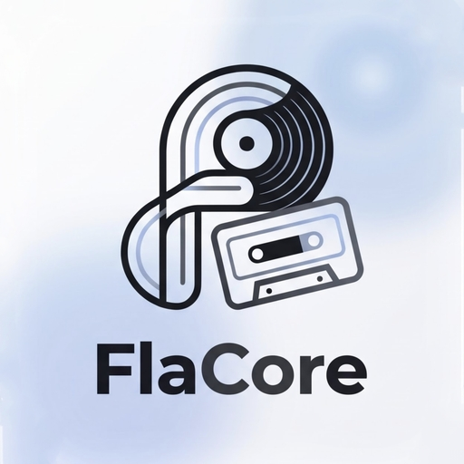
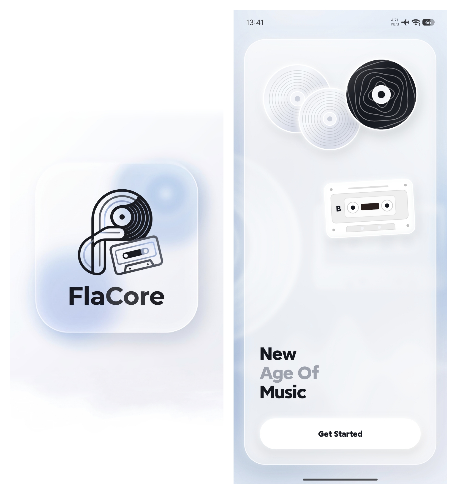
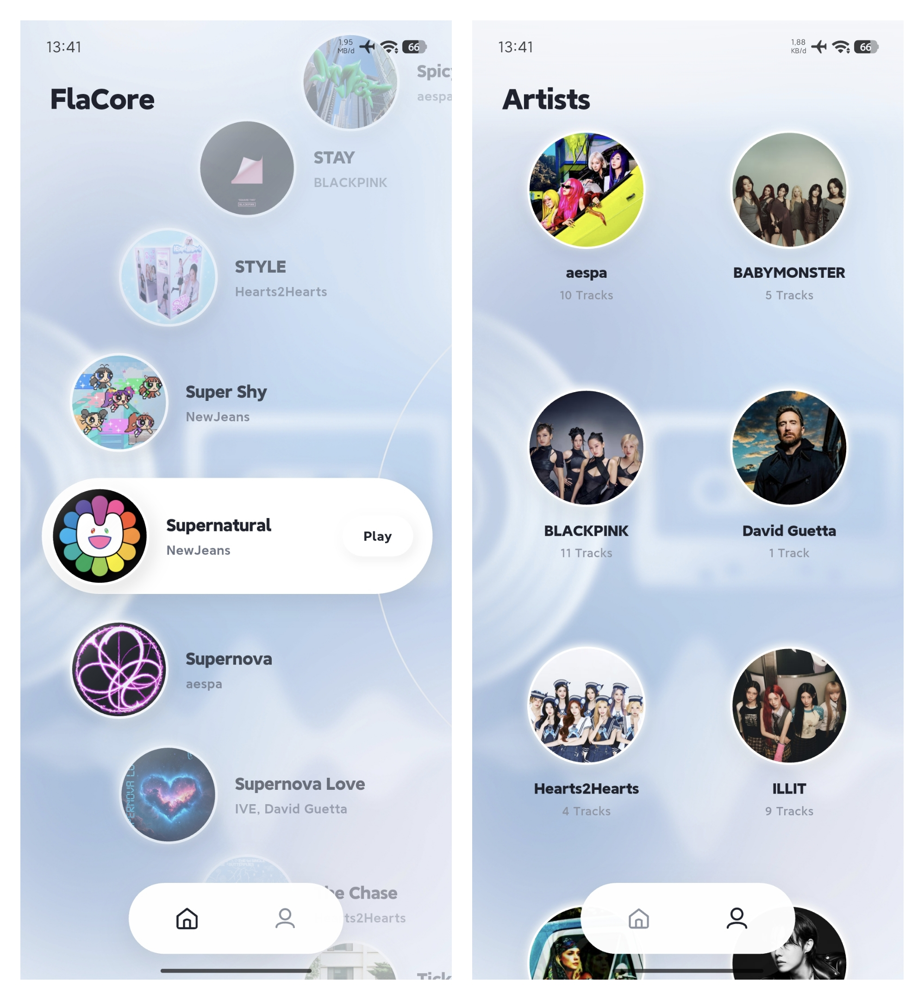
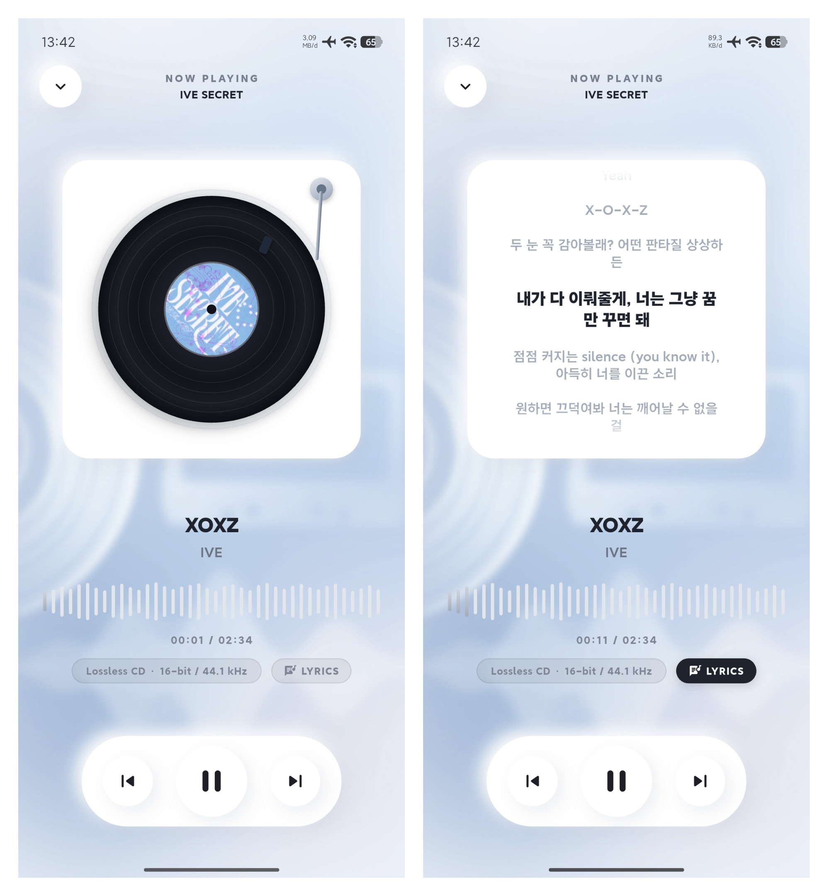

<div align="center">

# FlaCore (Android)
</div>
<div align="center">
  
  <h3>Ultra-Clean Neumorphic Hi-Res Lossless Audio Streaming Client</h3>
  <p>Aplikasi streaming audio FLAC Lossless berbasis Flutter dengan estetika <em>Soft Porcelain Neumorphism</em>, pemutar piringan hitam vinyl analog, lirik tersinkronisasi, dan integrasi Deezer Artist Profile.</p>

  <p>
    
    
    
    
    
  </p>
</div>

---

## 📸 Tampilan Aplikasi (Interface Showcase)

<div align="center">
  <table>
    <tr>
      <th align="center"><b>1. Brand Identity & Onboarding</b></th>
      <th align="center"><b>2. Explore & Artists Catalog</b></th>
      <th align="center"><b>3. Now Playing & Synced Lyrics</b></th>
    </tr>
    <tr>
      <td align="center" width="33%">
        
      </td>
      <td align="center" width="33%">
        
      </td>
      <td align="center" width="33%">
        
      </td>
    </tr>
    <tr>
      <td align="center" valign="top">
        <sub><b>Onboarding Interaktif</b><br/>Kartu frosted glassmorphism, tipografi tebal <em>"New Age Of Music"</em>, dan ilustrasi fisik CD & kaset.</sub>
      </td>
      <td align="center" valign="top">
        <sub><b>Katalog & Navigasi</b><br/><em>Arc Wheel Orbit Carousel</em> dengan CD berhologram & grid 2 kolom artis dengan foto Deezer API.</sub>
      </td>
      <td align="center" valign="top">
        <sub><b>Playback Engine</b><br/>Vinyl Turntable berputar dengan tonearm jarum analog, lirik karaoke auto-scroll, & waveform seekbar.</sub>
      </td>
    </tr>
  </table>
</div>

---

## 🌟 Fitur Utama

- 💎 **Ultra-Clean Soft Neumorphic & Glassmorphic UI**: Palet warna monokromatis *Cool Soft Blue Porcelain* (`#F4F7FB`), bayangan difus ultra-halus, dan kartu kaca transparan.
- 🚀 **Zero GPU Overhead**: Efek ambient blur menggunakan pre-baked low-overhead background texture tanpa shader blur dinamis yang berat, menjaga baterai tetap hemat dan HP tetap dingin.
- 💽 **Arc Wheel Orbit Carousel**: Navigasi katalog lagu di halaman Explore dengan lintasan orbit melengkung. Lagu aktif secara otomatis masuk ke kapsul *stadium* dengan CD avatar berhologram.
- 📻 **Vinyl Turntable Deck & Tonearm**: Tampilan pemutar piringan hitam vinyl berputar dengan alur cincin (*grooves*) dan lengan jarum (*tonearm*) analog yang bergerak saat memutar musik.
- 🎙️ **Real-Time Synced Lyrics (LRCLIB)**: Lirik karaoke tersinkronisasi waktu (*timestamped*) dari LRCLIB API dengan efek transisi auto-scroll presisi dan *fade shader mask*.
- 👥 **Deezer Public API Integration**: Foto profil artis resmi diambil secara dinamis dari Deezer API dengan sistem *in-memory cache* dan *local persistent storage* offline.
- 📊 **Interactive Waveform Seekbar**: Bar gelombang frekuensi monokrom abu-abu yang responsif terhadap tap dan drag geser untuk melakukan seek audio secara akurat.
- 🎧 **Hi-Res Lossless Audio Badge**: Deteksi otomatis bit-depth dan sample-rate audio (contoh: `Hi-Res Lossless • 24-bit / 96.0 kHz` atau `Lossless CD • 16-bit / 44.1 kHz`).
- 📱 **Full Android Background Playback**: Berjalan lancar di latar belakang berkat `audio_service`, `just_audio`, serta integrasi `MediaSessionCompat` dan kontrol Android Lock Screen / Bluetooth AVRCP.

---

## 🏗️ Tech Stack & Dependencies

- **Framework**: [Flutter](https://flutter.dev) (Dart SDK `^3.13.7`)
- **State Management**: [Provider](https://pub.dev/packages/provider)
- **Audio Engine**: 
  - [just_audio](https://pub.dev/packages/just_audio)
  - [audio_service](https://pub.dev/packages/audio_service)
  - [audio_session](https://pub.dev/packages/audio_session)
- **Network & Caching**:
  - [http](https://pub.dev/packages/http)
  - [cached_network_image](https://pub.dev/packages/cached_network_image)
  - [shared_preferences](https://pub.dev/packages/shared_preferences)
- **Permissions**: [permission_handler](https://pub.dev/packages/permission_handler) (Android 13+ Notification & Battery Optimization)
- **Typography**: [google_fonts](https://pub.dev/packages/google_fonts) (Inter)

---

## 📡 Tutorial Lengkap: Menghubungkan ke Server / Domain Anda

Aplikasi FlaCore dirancang agar **koneksi server bersifat netral dan modular**. Anda dapat menghubungkannya ke server FlaCore pribadi Anda, server VPS dengan domain HTTPS, atau server lokal (*Local Area Network* / LAN).

### 1. Di Mana Mengubah Alamat Server?

Buka file berikut pada project:
👉 `lib/core/constants/api_constants.dart`

Anda akan menemukan baris berikut:
```dart
class ApiConstants {
  ApiConstants._();

  /// Ganti nilai default ini dengan URL domain atau IP server FlaCore Anda:
  static const String baseUrl = String.fromEnvironment(
    'FLACORE_BASE_URL',
    defaultValue: 'https://your-flacore-server.example.com',
  );
  ...
}
```

### 2. Format URL yang Benar

| Tipe Server | Contoh Format yang Benar | Catatan |
|---|---|---|
| **Domain Publik (HTTPS)** | `https://music.yourdomain.com` | **Direkomendasikan**. Aman dan didukung penuh Android tanpa konfigurasi tambahan. |
| **Domain dengan Port** | `https://music.yourdomain.com:8443` | Sertakan port setelah domain jika tidak memakai port standar 443. |
| **IP Jaringan Lokal (HTTP)** | `http://192.168.1.100:3000` | Memerlukan izin *Cleartext Traffic* (lihat bagian troubleshooting di bawah). |

> ⚠️ **PENTING**: **JANGAN** menambahkan tanda garis miring (*trailing slash* `/`) di akhir URL.
> - ✅ Benar: `https://flacore.example.com`
> - ❌ Salah: `https://flacore.example.com/`

### 3. Menggunakan `--dart-define` (Tanpa Mengubah File Kode)

Jika Anda ingin menguji atau mem-build aplikasi dengan URL server berbeda tanpa mengubah file kode, Anda bisa menggunakan parameter `--dart-define`:

```bash
# Menjalankan di perangkat / emulator dengan server kustom:
flutter run --dart-define=FLACORE_BASE_URL=https://music.yourdomain.com

# Mem-build Release APK dengan server kustom:
flutter build apk --release --dart-define=FLACORE_BASE_URL=https://music.yourdomain.com
```

---

### 4. Spesifikasi Endpoint API Backend yang Dibutuhkan

Backend FlaCore Anda harus menyediakan 4 endpoint REST API berikut:

#### A. `GET /api/songs`
Mengembalikan daftar seluruh katalog lagu dalam format JSON.
- **Headers Response**: `Content-Type: application/json; charset=utf-8` (Wajib UTF-8 agar judul non-ASCII seperti bahasa Jepang/Korea tidak rusak).
- **Format JSON Response**:
```json
[
  {
    "id": "track-uuid-001",
    "title": "Supernova",
    "artist": "aespa",
    "album": "Armageddon - The 1st Album",
    "duration": 180,
    "bit_depth": 24,
    "sample_rate": 96000,
    "bitrate": 3154,
    "file_path": "/music/aespa/Supernova.flac",
    "has_cover": true,
    "created_at": "2026-05-13T10:00:00Z"
  }
]
```
*(Bisa berupa array langsung `[...]` atau object bersarang `{"songs": [...]}`)*.

#### B. `POST /api/scan`
Memicu backend untuk memindai ulang folder penyimpanan musik di server.
- **Response**: Status HTTP `200 OK` atau `202 Accepted`.

#### C. `GET /api/stream/{id}`
Menyajikan streaming langsung file audio FLAC untuk lagu dengan ID `{id}`.
- **Headers Response**: `Content-Type: audio/flac` (mendukung `Accept-Ranges: bytes` untuk fungsi seek audio).

#### D. `GET /api/songs/{id}/cover`
Menyajikan gambar cover art album (JPEG / PNG / WebP) untuk lagu terkait.
- **Headers Response**: `Content-Type: image/jpeg` atau `image/png`.

---

### 5. Troubleshooting Masalah Koneksi Jaringan

#### A. Menggunakan Server HTTP / IP Lokal (Bukan HTTPS)
Secara default, Android versi 9 (Pie) ke atas memblokir koneksi HTTP tanpa enkripsi (*Cleartext HTTP traffic*).
Jika server Anda menggunakan IP lokal (misalnya `http://192.168.x.x:3000`), buka:
👉 `android/app/src/main/AndroidManifest.xml`

Tambahkan atribut `android:usesCleartextTraffic="true"` pada tag `<application>`:
```xml
<application
    android:label="FlaCore"
    android:name="${applicationName}"
    android:icon="@mipmap/ic_launcher"
    android:usesCleartextTraffic="true">
```

#### B. Mengakses Server Lokal dari Emulator Android
- Jika menjalankan server di komputer lokal (`localhost:3000`) dan menguji di **Android Emulator**, gunakan alamat IP `http://10.0.2.2:3000` (bukan `localhost`).
- Jika menguji di **HP Fisik**, pastikan HP dan komputer server terhubung ke jaringan Wi-Fi yang sama, dan gunakan IP lokal komputer (misal: `http://192.168.1.50:3000`).

---

## 🚀 Panduan Memulai (Setup & Installation)

### Prasyarat
1. [Flutter SDK](https://docs.flutter.dev/get-started/install) versi 3.13.7 atau lebih baru.
2. [Android Studio](https://developer.android.com/studio) dengan Android SDK & Command-line Tools terpasang.
3. Git.

### Langkah Instalasi
```bash
# 1. Clone repository
git clone https://github.com/your-username/FlaCore-App.git
cd FlaCore-App

# 2. Ambil seluruh dependencies
flutter pub get

# 3. Jalankan unit & widget test untuk memverifikasi integritas kode
flutter test

# 4. Jalankan aplikasi di perangkat Android / Emulator
flutter run
```

### Membuat APK Release
Untuk membuat file installer Android APK mandiri:
```bash
flutter build apk --release
```
File APK siap instal akan berada di: `build/app/outputs/flutter-apk/app-release.apk`.

---

## 📁 Struktur Direktori Project

```text
FlaCore-App/
├── android/                  # Proyek native Android (Gradle, Manifest, ProGuard)
├── images/                   # Asset gambar aplikasi (Logo, Ambient Background)
├── lib/                      # Kode sumber utama Flutter (Dart)
│   ├── core/
│   │   ├── constants/        # ApiConstants (Konfigurasi URL Server)
│   │   ├── theme/            # AppTheme (Neumorphism, Concave, Glassmorphism)
│   │   └── utils/            # Formatters (Durasi, Hi-Res Quality Badges)
│   ├── data/
│   │   ├── models/           # Song model & JSON serialization
│   │   └── services/         # ApiService, LyricsService, Deezer, AudioHandler
│   ├── providers/            # LibraryProvider & PlayerProvider
│   ├── ui/
│   │   ├── screens/          # Explore, Artists, Detail, NowPlaying, Onboarding
│   │   └── widgets/          # MiniPlayer
│   └── main.dart             # Inisialisasi AudioService & App Shell
├── test/                     # 24 Unit & Widget Tests komprehensif
├── pubspec.yaml              # Deklarasi dependencies & asset
└── README.md                 # Dokumentasi & panduan lengkap
```

---

## 🔒 Privasi & Keamanan
- Aplikasi ini **tidak mengumpulkan atau melacak data pribadi pengguna**.
- Fitur pencarian foto profil artis menggunakan Deezer Public API yang tidak memerlukan kredensial login atau token berbayar.
- Fitur lirik lagu menggunakan LRCLIB API publik dengan transmisi data anonim.

---

## 🤝 Berkontribusi
Kontribusi, perbaikan bug, dan penambahan fitur selalu disambut baik!
1. Fork repository ini.
2. Buat branch fitur baru (`git checkout -b feature/NamaFitur`).
3. Commit perubahan Anda (`git commit -m 'Add fiturn baru'`).
4. Push ke branch Anda (`git push origin feature/NamaFitur`).
5. Buat Pull Request.

---

## 📄 Lisensi
Didistribusikan di bawah lisensi MIT. Silakan gunakan, pelajari, dan kembangkan secara bebas untuk keperluan personal maupun open source.
